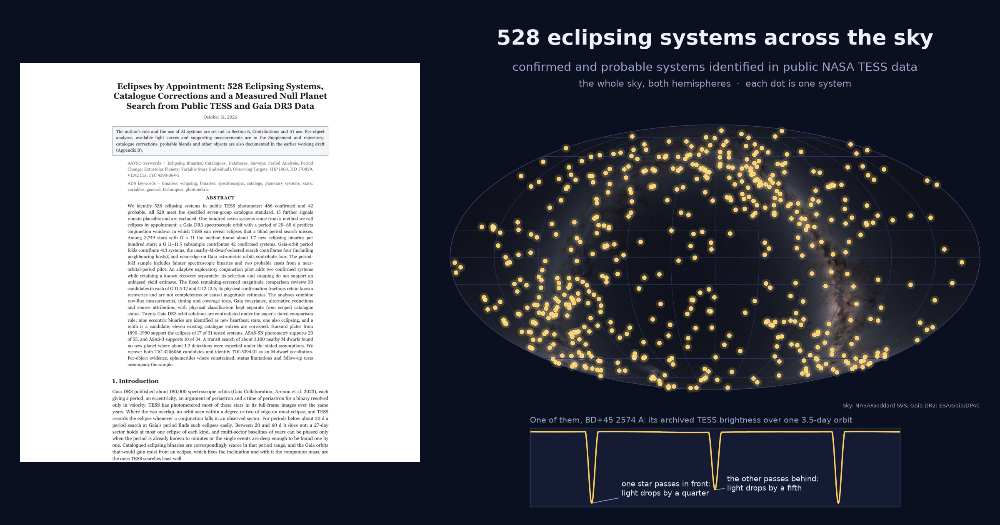

# Eclipses by Appointment

**404 eclipsing systems: 376 confirmed and 28 probable.** All 404 meet the specified seven-group uncatalogued standard; thirteen plausible cases remain excluded. Catalogue non-matches are bounded searches, not an exhaustive priority claim.

This is one evolving **paper, v1.0**. It has **not been formally submitted** to a journal and is not under formal review.

Gaia measures the orbits of binary stars. We use those orbits to predict when eclipses can occur, then examine public TESS photometry for the expected dips. The paper combines that search with period folds, nearby-M-dwarf transit searches, source-attribution tests and individual follow-up. Physical confirmation and catalogue novelty are recorded separately.

## Paper and evidence

The scientific search populations contribute **83 systems from predicted spectroscopic conjunctions, 313 from Gaia-orbit period folds, four from the nearby-M-dwarf-selected search (including neighbouring hosts), and four from near-edge-on Gaia astrometric orbits**. The fainter SB1 systems use the same period-fold method and physical criteria.

- [Current paper](paper.pdf): methods, physical findings, the original catalogue measurements in Appendix A, and a unified physical-outcome register in Appendix C.
- [Supplement](supplement.pdf): scientific method/population guide and unified outcome navigation, followed by illustrated entries and preserved detailed evidence.
- [Unified scientific review register](scientific-review-register.csv): all 246 R/C reviews with method, population, physical status, unique-count flag, scientific outcome and stable report/anchor links. It contains 189 confirmed and 16 probable additions, seven known recoveries/controls, 13 plausible signals and 21 non-EB, neighbouring-source or systematic outcomes. The A4 control is already in the original catalogue and adds nothing again.
- [R evidence register](reviewed-extension.csv) and [C evidence register](returned-review.csv): original compatible CSV links. R/C labels are archival keys, not scientific methods or physical classes. The [detailed evidence archive](reviews/cloud72-completion-2026-10-30/README.md), [earlier reports](reviews/c9a-return/README.md), and [catalogue reconciliation](reviews/novelty-reconciliation/README.md) preserve provenance and measurements.
- [Earlier working draft](historical-draft-2026-10-14.pdf): archived draft, not a formally submitted version.

Among 242 individually reviewed G 10-11.5 period-fold candidates, 230 are confirmed (including three known recoveries), nine probable, two non-eclipsing heartbeat stars and one plausible. These are a reviewed subset, not the denominator for the full period-fold search. Catalogue non-matches retain their stated search scope.

The overview graphic shows the original 199 A-labelled systems, a subset of the full 404-system sample.

**Related work.** The method is not new. Théo Chopard-Vilhem deposited the same search on Zenodo
on 2026 September 27, two weeks before this work began
([10.5281/zenodo.22998328](https://doi.org/10.5281/zenodo.22998328): 9,389 Gaia spectroscopic orbits, 93 eclipsing
systems at 13 to 119 days, object list embargoed until his paper is accepted), and on October 13 an open record of the
same test on near-edge-on Gaia astrometric orbits ([10.5281/zenodo.23342415](https://doi.org/10.5281/zenodo.23342415)).
Our initial literature search missed these records because it did not include Zenodo. The paper cites both records and does not claim priority for the method. The current open release ([version 1.2.0](https://doi.org/10.5281/zenodo.23405354)) shares one surviving detection with us (HD 170829, A20). A positional comparison of all 235 catalogue-ledger rows and exact TIC matching retain the earlier A20 overlap and three parent-list overlaps that are not additional shared claimed detections. The retained exact-identifier comparisons of reviewed spectroscopic-orbit candidates found no additional overlap with the open parent list or dossier. The comparison sets, identifiers and coverage are recorded in the catalogue receipts; these bounded checks do not establish exhaustive priority. The overlap with the embargoed September list remains unknown. A reader of this work pointed us to the records.

## Contributions

The project coordinator posed the question, directs the work and is responsible for the claims. Fable 5 found the period-fold candidates. **Astra** supervised the spectroscopic-orbit period-fold follow-up, reviewed exceptional cases, reconciled the evidence and integrated the results; fresh **GPT-6.1 Sol leads and Terra helpers** performed detailed measurements and checks. **Fable 5.1 and Opus 5.5 helpers** performed independent source-attribution and orbital reviews; Astra reconciled those results and incorporated their evidence into the paper and supplement. Section 6 credits the other contributors and distinguishes independent analyses from reused methods. [Contributor record](reviews/2026-10-30/CONTRIBUTORS.md).

We thank all contributors who assisted with screening, evidence collection, analysis, review and reconciliation, and the project coordinator for coordinating the work.

## Check it yourself

[`CHECKCARD.csv`](CHECKCARD.csv) is an earlier 190-row observing card: the numbered
systems, the catalogue corrections, the planet candidates and the heartbeat stars. Each carries identifiers,
coordinates, magnitude, the ephemeris as published, the eclipse depth and duration, the **next predicted primary
eclipse in UTC** (for the shortest periods, step forward by whole periods), and the one-line `lightkurve` call that
downloads the raw TESS light curve. Every row also carries a `computed_UTC` column holding the second at which the
card was generated, so a copy of this file never loses its own age; this one was generated on 2026 October 19 and does not cover the full current sample. Three
cautions. `sigma_from_eP_min` is cycles times the period error and nothing else, so it is a lower bound on the timing
uncertainty. The UTC times are for an observer on Earth: light-travel time to the solar-system barycentre is removed,
by code checked against a separately written implementation over all 168 predicted objects, the two agreeing to 2.6 s
&mdash; and that whole disagreement is the Sun's own displacement from the barycentre, which the checking
implementation deliberately omits (0.3 to 3.7 light-seconds over the coming decade; subtract it and 0.06 s is left).
And the unique key is `(label, TIC)` rather than either column alone: twelve unnumbered rows share the label `D`, and
two TICs carry two planet candidates each. Rows without a period or an epoch are kept, with the reason in `note`.

[`batch-candidates.csv`](batch-candidates.csv) preserves all 266 screening rows and their current review statuses. Its numerical screening fields retain their original meaning; fitted measurements and limitations belong to the individual reports. Current R-labelled verdicts comprise 164 confirmed, 9 probable and one plausible. All 170 R additions meet the seven-group uncatalogued standard after coverage recovery; the three known recoveries are excluded. The dated tier reconciliation supersedes historical labels without changing old reports.

## Data and code

The repository includes reports, compact measurements, acquisition manifests and analysis scripts. Raw TESS products can be fetched from their preserved MAST URLs. Scripts retain workspace assumptions and are not a turnkey package. The dated report folders preserve provenance within this single working paper.
