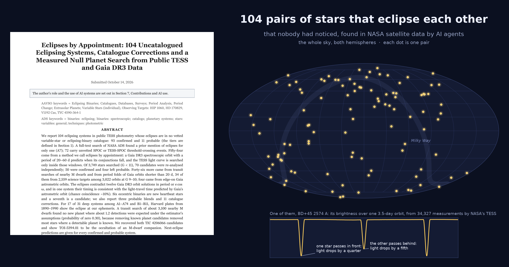

# Eclipses by Appointment

**174 pairs of stars that eclipse each other, which no catalogue had recorded, found in public data from NASA's TESS
satellite and ESA's Gaia mission.**

Some stars come in pairs that orbit each other. When the orbit is seen nearly edge-on, each star passes in front of
the other once per orbit, and from Earth the pair's light dips on a regular schedule. Gaia measured the orbits of
hundreds of thousands of such pairs from the tiny shifts in the colour of their light as the stars swing towards and
away from us. This work used those orbits to predict *when* an
eclipse should happen, looked in TESS's brightness measurements at exactly those times, and found eclipses that
nobody had catalogued.

## The paper

- [`paper.pdf`](paper.pdf): the paper, shortened version, last updated 2026 October 21 (30 pages; the catalogue of all 174
  systems with their ephemerides and next eclipses is its Appendix A)
- [`supplement.pdf`](supplement.pdf): one entry per system, with its light curve (153 pages)
- [`paper-as-submitted.pdf`](paper-as-submitted.pdf): the 57-page version sent to the journal on October 14 (with the deposit link removed)

*Eclipses by Appointment: 104 Uncatalogued Eclipsing Systems, Catalogue Corrections and a Measured Null Planet Search
from Public TESS and Gaia DR3 Data.* Submitted to the Journal of the AAVSO on 2026 October 14; under review; not yet
refereed. The first outside reader said, rightly, that 57 pages was not a reviewable paper and that it read like a
working notebook. The shortened version above is the same results written as a journal paper: about 5,000 words of
text, the systems in one table, a literature review, and the per-object detail left to the supplement. It also carries
results found after submission: ASAS-SN photometry from 2014 to 2018 shows the eclipses of 20 of the 55 systems it
could test, at the predicted times, with the depths matching the predictions in the 11 examined; ASAS-3 photometry
from 2000 to 2009 shows them for 10 of 34; and one more system (A108) is seen on the Harvard plates. One sentence of
the submitted version is corrected: on the plates A63 is consistent with its TESS eclipse depth, not absent, once the
eclipse shape is used.

**Prior work (added 2026 October 15).** The method is not new. Théo Chopard-Vilhem deposited the same search on Zenodo
on 2026 September 27, two weeks before this work began
([10.5281/zenodo.22998328](https://doi.org/10.5281/zenodo.22998328): 9,389 Gaia spectroscopic orbits, 93 eclipsing
systems at 13 to 119 days, object list embargoed until his paper is accepted), and on October 13 an open record of the
same test on near-edge-on Gaia astrometric orbits ([10.5281/zenodo.23342415](https://doi.org/10.5281/zenodo.23342415)).
Both versions of our paper say we were not aware of a previous search of this kind; that was true when written and is
now false, because our literature search did not include Zenodo. The current `paper.pdf` cites both records and drops the
claim. Matched by Gaia source identifier, the open October record shares one detection with us (HD 170829, our A20) and
lists three more of our objects among its unclaimed candidates. The overlap with the embargoed September list is not yet
known. A reader of this work pointed us to the records.

In short: 174 eclipsing systems (162 confirmed, 12 probable) that are in no vetted variable-star or eclipsing-binary
catalogue; nineteen Gaia orbit solutions the eclipses contradict; nine new heartbeat stars; eleven corrections to existing
catalogue entries; old Harvard photographic plates (1890-1990) that show the eclipses of 17 systems at the predicted
times; a transit search of about 3,100 nearby red dwarfs that found no new planet, with the reason measured; and the
predicted time of the next eclipse for every system, so that anyone with a telescope can check them.

## How it was done

The searches, measurements, checks and writing were carried out by AI agents (Claude models from Anthropic and GPT
models from OpenAI) running on one home computer, with a human author who posed the question, directed the work and is
responsible for what is claimed. Every candidate from the main searches was re-analysed independently with separately written code before
being counted. Section 6 of the paper sets out who did what.

## Check it yourself

[`CHECKCARD.csv`](CHECKCARD.csv) is one row per row of the paper's object table &mdash; 190 of them: the numbered
systems, the catalogue corrections, the planet candidates and the heartbeat stars. Each carries identifiers,
coordinates, magnitude, the ephemeris as published, the eclipse depth and duration, the **next predicted primary
eclipse in UTC** (for the shortest periods, step forward by whole periods), and the one-line `lightkurve` call that
downloads the raw TESS light curve. Every row also carries a `computed_UTC` column holding the second at which the
card was generated, so a copy of this file never loses its own age; this one was generated on 2026 October 19. Three
cautions. `sigma_from_eP_min` is cycles times the period error and nothing else, so it is a lower bound on the timing
uncertainty. The UTC times are for an observer on Earth: light-travel time to the solar-system barycentre is removed,
by code checked against a separately written implementation over all 168 predicted objects, the two agreeing to 2.6 s
&mdash; and that whole disagreement is the Sun's own displacement from the barycentre, which the checking
implementation deliberately omits (0.3 to 3.7 light-seconds over the coming decade; subtract it and 0.06 s is left).
And the unique key is `(label, TIC)` rather than either column alone: twelve unnumbered rows share the label `D`, and
two TICs carry two planet candidates each. Rows without a period or an epoch are kept, with the reason in `note`.

[`batch-candidates.csv`](batch-candidates.csv) (added 2026 October 17) is one row per candidate from the period folds of Gaia orbits shorter than 20 d at G 10-11.5: 266 rows that passed the same tests run in bulk (conjunction attribution on Gaia's orbit, per-sector depth consistency, difference imaging), with the status each row holds after an adversarial review that queried ExoFOP, VSX and SIMBAD and re-folded 60 at random from fresh TESS data. After the per-object re-analysis of the eight the difference imaging had flagged and of the 55 shallowest of the others (2026 October 18-21), 61 are `confirmed, counted as A119`-`A179` and two are `heartbeat` stars; 179 are `candidate`; the rest are TESS Objects of Interest already called false positives or eclipsing binaries, known signals that Gaia's orbit newly attributes to a stellar companion, VSX variables whose period or type the eclipses correct, or one hold. The 179 are not counted, because they have not had the per-object re-analysis the paper requires; they are published so that anyone can check them. The `conjunction_offset_phase` column was re-signed on 2026 October 20: the table generator had printed every negative offset as positive (`min(abs(d1), abs(d2))` formatted with a sign), so 126 of the 266 rows carried a false `+`. Magnitudes are unchanged, and so is every status.

## Data and code

Everything behind the paper (code, per-system analysis reports, ephemerides, figures and tables) is in a public data
deposit, available from the author.
