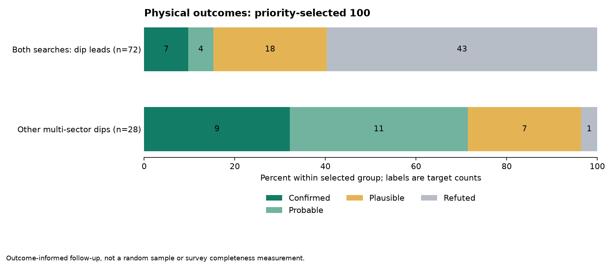

# Priority-selected 100: completed physical reviews

All 100 targets received completed bounded reviews and root acceptance. 16 confirmed, 15 probable, 25 plausible, 44 refuted, 0 non eclipse variable, 0 unresolved.

| Selected group | Reviewed | Confirmed | Probable | Plausible | Refuted selected signal | Other variable | Unresolved |
|---|---:|---:|---:|---:|---:|---:|---:|
| Both searches: dip leads | 72 | 7 | 4 | 18 | 43 | 0 | 0 |
| Other multi-sector dips | 28 | 9 | 11 | 7 | 1 | 0 | 0 |

Confirmed-or-probable fractions in this selected queue: 11/72 (15.3%) in both searches: dip leads; 20/28 (71.4%) in other multi-sector dips. These groups were selected differently, so the contrast is descriptive.

The ordering should not be read as a smooth probability gradient: membership in both searches came before contrast in the frozen queue. Future review priorities can test interleaving the strongest other multi-sector dips with cross-method leads; this campaign does not supply a validated score or justify discarding the remainder.

## Outcomes along the priority order

These ten-target blocks describe this fixed queue only. The ranking was informed by earlier outcomes, and the selection changes search group after target 72; these counts do not validate a general ranking model.

| Queue positions | Confirmed | Probable | Plausible | Other outcomes |
|---|---:|---:|---:|---:|
| 1-10 | 5 | 2 | 2 | 1 |
| 11-20 | 2 | 0 | 0 | 8 |
| 21-30 | 0 | 1 | 2 | 7 |
| 31-40 | 0 | 0 | 2 | 8 |
| 41-50 | 0 | 1 | 3 | 6 |
| 51-60 | 0 | 0 | 2 | 8 |
| 61-70 | 0 | 0 | 6 | 4 |
| 71-80 | 2 | 6 | 1 | 1 |
| 81-90 | 3 | 4 | 2 | 1 |
| 91-100 | 4 | 1 | 5 | 0 |

## Selection and interpretation

This is the first 100 of the frozen priority queue: all 72 remaining cross-method dip leads and the 28 highest-contrast other multi-sector dip leads. The choice was informed by the preceding stratified 100 review. Selection was committed at e62392520 before this campaign; there were no substitutions. T001-T100 are local review IDs, not accepted-system identifiers.

These are descriptive outcomes of this selected follow-up. Differences from the earlier random-within-stratum sample do not establish a validated classifier or survey-wide discovery rate. Contrast, flag counts, Gaia agreement and common-mode counts were not converted automatically into verdicts.

Initial source packets verified 931 cached light curves against frozen source hashes and TIC headers. Fresh Sol/Terra pairs reviewed each ten-target batch; shared catalogue queries were centralized. Root acceptance records identify deciding exceptions and follow-up work. Physical confirmation and catalogue novelty remain separate; no claim ledger or manuscript was changed during this campaign.

Confirmed requires supported recurring raw eclipses, measured timing with relevant aliases addressed, target attribution, an alternative reduction and compatible orbital geometry. Probable retains real recurrence with an unresolved check. Plausible includes single events or untested clocks. Refutation applies to the selected signal, not proof that the star cannot host a binary.

## Confirmed and probable signals

| Local ID | TIC | Tier | Photometric period (d) | Catalogue status | Evidence |
|---|---:|---|---:|---|---|
| T001 | 219739532 | Probable | 28.035775 | UNKNOWN | [Report](batch01/219739532/REPORT.md) |
| T002 | 92234103 | Probable | 24.620831 | UNKNOWN | [Report](batch01/92234103/REPORT.md) |
| T003 | 123365080 | Confirmed | 48.527672 | UNKNOWN | [Report](batch01/123365080/REPORT.md) |
| T004 | 241629469 | Confirmed | 38.115712 | UNKNOWN | [Report](batch01/241629469/REPORT.md) |
| T005 | 281017895 | Confirmed | 28.028754 | UNKNOWN | [Report](batch01/281017895/REPORT.md) |
| T006 | 46744354 | Confirmed | 43.062062 | UNKNOWN | [Report](batch01/46744354/REPORT.md) |
| T009 | 466741366 | Confirmed | 42.568962 | UNKNOWN | [Report](batch01/466741366/REPORT.md) |
| T012 | 323458448 | Confirmed | 46.86672 | UNKNOWN | [Report](batch02/323458448/REPORT.md) |
| T014 | 313142904 | Confirmed | 49.32737 | UNKNOWN | [Report](batch02/313142904/REPORT.md) |
| T026 | 341688154 | Probable | 58.157443 | UNKNOWN | [Report](batch03/341688154/REPORT.md) |
| T042 | 255912894 | Probable | 47.387088 | UNKNOWN | [Report](batch05/255912894/REPORT.md) |
| T073 | 102069549 | Probable | 24.592168 | UNKNOWN | [Report](batch08/102069549/REPORT.md) |
| T074 | 435855781 | Confirmed | 22.450616 | KNOWN | [Report](batch08/435855781/REPORT.md) |
| T075 | 33065877 | Confirmed | 30.092022 | UNKNOWN | [Report](batch08/33065877/REPORT.md) |
| T076 | 325469795 | Probable | 26.459431 | UNKNOWN | [Report](batch08/325469795/REPORT.md) |
| T077 | 414805769 | Probable | 14.291385 | UNKNOWN | [Report](batch08/414805769/REPORT.md) |
| T078 | 99725941 | Probable | 44.924411 | UNKNOWN | [Report](batch08/99725941/REPORT.md) |
| T079 | 150429807 | Probable | 44.383604 | UNKNOWN | [Report](batch08/150429807/REPORT.md) |
| T080 | 64829183 | Probable | 43.141264 | UNKNOWN | [Report](batch08/64829183/REPORT.md) |
| T081 | 37770031 | Probable | 10.518241 | UNKNOWN | [Report](batch09/37770031/REPORT.md) |
| T082 | 390155697 | Probable | 16.203989 | UNKNOWN | [Report](batch09/390155697/REPORT.md) |
| T083 | 271053559 | Probable | 24.655219 | UNKNOWN | [Report](batch09/271053559/REPORT.md) |
| T086 | 398402989 | Confirmed | 58.731513 | KNOWN | [Report](batch09/398402989/REPORT.md) |
| T087 | 200743349 | Confirmed | 26.532911 | UNKNOWN | [Report](batch09/200743349/REPORT.md) |
| T089 | 410314066 | Confirmed | 29.74905 | UNKNOWN | [Report](batch09/410314066/REPORT.md) |
| T090 | 71294892 | Probable | 3.2089 | UNKNOWN | [Report](batch09/71294892/REPORT.md) |
| T091 | 420645189 | Confirmed | 48.533875 | KNOWN | [Report](batch10/420645189/REPORT.md) |
| T096 | 356733570 | Confirmed | 34.108492 | UNKNOWN | [Report](batch10/356733570/REPORT.md) |
| T098 | 117404582 | Confirmed | 34.786 | UNKNOWN | [Report](batch10/117404582/REPORT.md) |
| T099 | 29551987 | Confirmed | 28.791 | UNKNOWN | [Report](batch10/29551987/REPORT.md) |
| T100 | 95244521 | Probable | Unresolved | UNKNOWN | [Report](batch10/95244521/REPORT.md) |

Periods retain their source-specific precision and limitations; consult the linked reports.

## Catalogue status

Row-derived novelty status counts: {"UNKNOWN": 97, "KNOWN": 3}. See [shared catalogue report](shared-catalogues/REPORT.md) and target-specific receipts for scopes, matches and unavailable checks. Missing queries are not negative matches.

## Evidence and reproducibility

Raw FITS and downloaded cutout bodies remain in the local data cache and are excluded from Git. Source receipts retain paths or retrieval URLs and hashes; reproducing the analysis requires those raw inputs as well as the tracked scripts. A local hash check does not make the repository a self-contained data archive.

- `accepted-results.csv` and `accepted-summary.json`: root-accepted outcomes.
- `batch01` through `batch10`: per-target reports, measurements, source receipts, lead/helper audits and root acceptance.
- `queue.csv` and `queue-seal.json`: exact selection and hashes.
- `source-packets/`: original identity and light-curve verification.
- `FINAL-VERIFICATION.json` and `FINAL-SHA256SUMS.json`: integrity verification and artifact seal.

[redacted]'s appreciation was passed to every helper.
