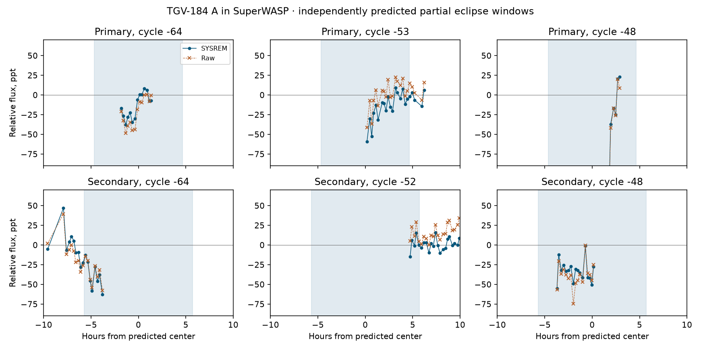

# TGV-184 A observer note

**Predicted primary minimum on 29 November 2026 at 21:45 UTC.** TGV-184, TIC 270360534, is at **17h 33m 43.3s, +43° 51′ 38.7″** (ICRS 263.430502°, +43.860752°), TESS magnitude 11.24. The discovery paper identified two sets of eclipses and reported the 33.2179-day period of pair B. The timing test below concerns pair A. [Discovery paper](https://publicatio.bibl.u-szeged.hu/39068/1/Kostovetal_MNRAS527.3995_stad2947.pdf).

| Primary of A | Approximate start UTC | Midpoint UTC | Approximate end UTC | Period test |
|---|---|---|---|---|
| November 2026 | Nov 29, 17:06 | Nov 29, 21:45 | Nov 30, 02:24 | Three of ten TESS-compatible periods predict an eclipse. |
| February 2027 | Feb 28, 01:51 | Feb 28, 06:30 | Feb 28, 11:09 | Only the proposed 90.36632-day period predicts an eclipse among those ten. |

Three TESS primary eclipses lasted about 9.3 hours and removed 6.3–8.2% of the measured light. The depth depends on filter and dilution. Record the filter, time standard and exposure midpoint. A partial ingress or egress can constrain the timing when observations include a stable out-of-eclipse baseline. The target remains above 25° and the Sun below −12° throughout the November window at Longyearbyen. Representative geometry allows part of that window from southern England, Reykjavík and the northeastern United States. In February, Tenerife and the northeastern United States have access to the predicted midpoint. [Site visibility](TGV-184-visibility.csv) · [Prediction table](TGV-184-windows.csv).

## Historical timing test

**Primary ephemeris: BJD TDB = 2459024.88097 + 90.36631998 × E.** Three TESS primaries and archival ground nights favor eight orbits between successive observed TESS primaries. A partially sampled SuperWASP egress on 14–15 May 2007, 53 cycles before the first TESS primary, also supports that cycle count. Of ten TESS-compatible alternatives, only this clock puts A in eclipse then. The closest B eclipse is 5.3 days away.

The 2007 event has 88 SuperWASP exposures in the tested core, grouped into nine quarter-hour bins. The measured losses are 27.4 parts per thousand after SYSREM and 7.6 parts per thousand in raw flux. Zero of 42 camera-matched shifted-night SYSREM controls are as deep. A separate camera-144 comparison across the same night gives excess contrasts of 30.4 and 30.1 parts per thousand after correcting for systematic time-of-night variation. Both reductions use the same exposures. The partial coverage and the photometric normalization limit the precision of the archival timing. Eighteen plausible reductions give a four-minute range for the November 2026 midpoint before considering possible timing shifts from the system's dynamics.

The data are from SuperWASP DR1 source 1SWASP J173343.33+435138.8. The original timestamps already include a heliocentric correction. Conversion to BJD TDB used the clock-standard change and the projected Sun-to-barycentre correction. Camera and season baselines use out-of-eclipse nights. Recovered eclipses of B serve as positive controls. [Archive file and hash](TGV-184-wasp-archive.json) · [Event windows](TGV-184-wasp-events.csv) · [Shifted-night controls](TGV-184-wasp-controls.csv) · [Within-night tests](TGV-184-within-night.csv) · [Period alternatives](TGV-184-aliases.csv) · [Plot samples](TGV-184-profiles.csv).
