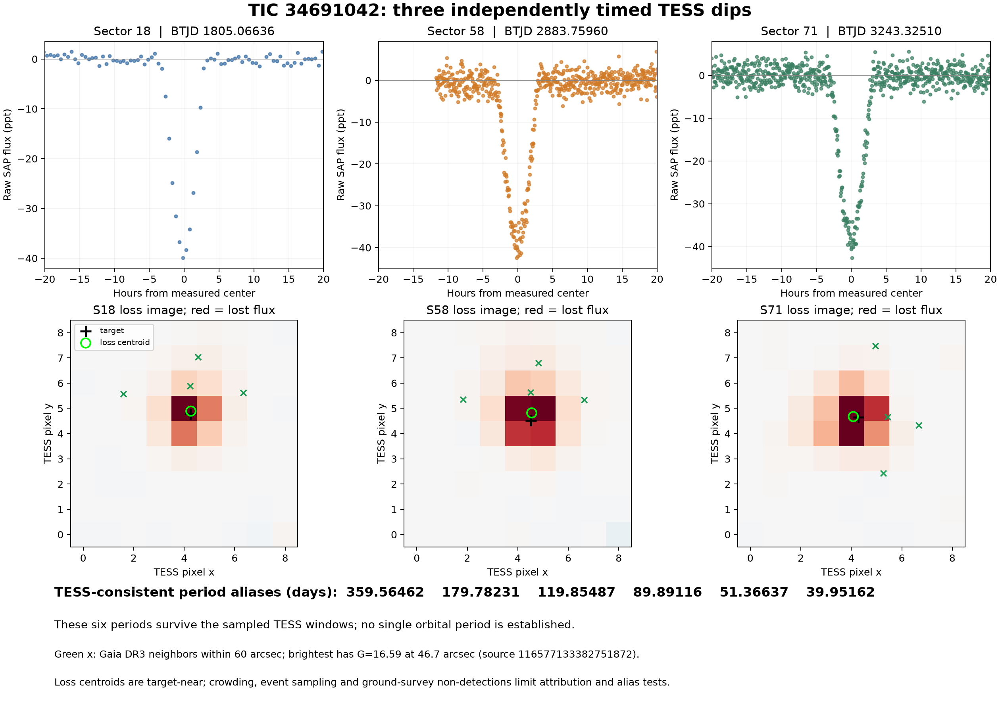

# Three eclipses near TIC 34691042

TESS recorded three eclipses lasting about six hours and removing 3.7% of the measured light. Three difference images place the flux deficit within 0.31 TESS pixel of TIC 34691042. Independent reductions of the TESS images recover the same events. No catalogued neighbor within 90 arcseconds with a measured TESS magnitude can supply 80% of the observed loss under the equal-throughput test. An unresolved neighbor remains possible.

The field contains a known 13.65183-day Gaia spectroscopic binary. The third eclipse occurs 4.48 days from the prediction for the short clock. If all three events are the same kind of eclipse, their intervals are close to three units and one unit of 359.565 days. Testing the integer divisors against eight TESS visits leaves six periods of at least half a day.

| Divisor | Possible period (days) |
|---:|---:|
| 1 | 359.5646 |
| 2 | 179.7823 |
| 3 | 119.8549 |
| 4 | 89.8912 |
| 7 | 51.3664 |
| 9 | 39.9516 |

The archival comparison covers 2,479 ASAS-SN measurements and 9,329 SuperWASP exposures. Several shorter periods predict ground minima in windows with shallower or absent fading. Sparse coverage, camera and passband differences, dilution and timing uncertainty prevent choosing a single clock. The source remains outside the 107-system count. [Measured events](TIC-34691042-events.csv) · [Integer period tests](TIC-34691042-aliases.csv) · [ASAS-SN comparisons](TIC-34691042-ground.csv) · [SuperWASP comparisons](TIC-34691042-wasp.csv).

## Observing windows

The target is at ICRS **45.59363°, +27.90437°** and TESS magnitude **11.27**. These windows are geocentric UTC midpoints from a three-event linear fit. If the eclipse remains six hours long, it should begin about three hours before the midpoint. Out-of-eclipse baseline before or after the event helps characterize the loss. Actual timing may vary.

| Midpoint UTC | Periods predicting an eclipse |
|---|---|
| 2026 Nov 28, 21:05 | 51.3664 d only |
| 2026 Dec 27, 10:00 | 39.9516 d only |
| 2027 Jan 6, 09:44 | 89.8912 d only |
| 2027 Feb 5, 08:55 | 119.8549 or 39.9516 d |
| 2027 Oct 3, 01:52 | All six |

[Full prediction table](TIC-34691042-windows.csv) · [Plotted SAP samples](TIC-34691042-profiles.csv) · [Difference-image arrays](TIC-34691042-differences.json) · [Review summary](../index.md).
