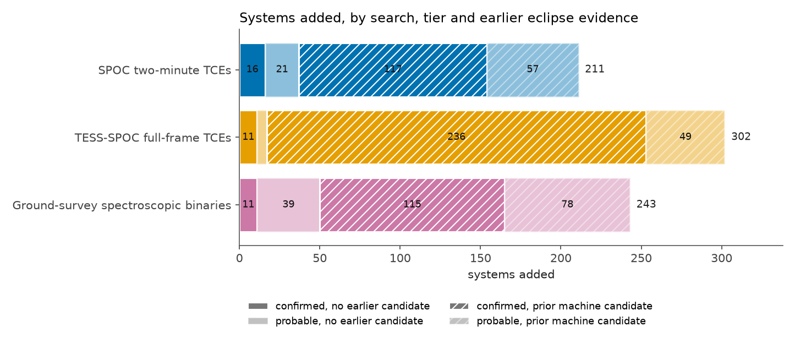

# November 23 review of pipeline detections and ground-survey binaries

**756 systems** are included in this release from three searches. The measurements support a confirmed classification for **506** and a probable classification for **250**. The catalogue and literature checks found no earlier eclipse candidate for **104** systems. The other **652** are validations of earlier machine-selected candidates: the unvetted machine-learning list of Kostov et al. (2025, table 2) and/or the Gaia DR3 variability classifier. Publication history and the physical classification are tracked separately.

| Earlier eclipse evidence | Confirmed | Probable | Total |
|---|---:|---:|---:|
| No earlier candidate in the sources checked | 38 | 66 | 104 |
| Prior machine-selected candidate | 468 | 184 | 652 |
| Total | 506 | 250 | 756 |

| Search | Stars reviewed | Confirmed | Probable | No earlier candidate | Prior machine candidate | Added |
|---|---:|---:|---:|---:|---:|---:|
| SPOC two-minute threshold-crossing events not promoted to objects of interest | 299 | 133 | 78 | 37 | 174 | **211** |
| TESS-SPOC full-frame threshold-crossing events not promoted to objects of interest | 348 | 247 | 55 | 17 | 285 | **302** |
| Spectroscopic binaries from ground-based surveys (LAMOST, APOGEE, GALAH, RAVE, Gaia-ESO) | 517 | 126 | 117 | 50 | 193 | **243** |

Three stars were reviewed in two searches, so the column sums to 1,164.

- [Host table, R946–R1701](host-stars.csv) gives identifiers, sky coordinates, the search that found each system, adopted periods and reference epochs, depths, attribution, ground-survey detections, the reason for the tier and its limitation.
- [All 1,161 reviewed stars](reviewed-stars.csv) with the outcome of each review, including stars not added.
- [Methods and data dictionary](methods.md) explains the three searches, the criteria and the limitations.
- Summary figures: [periods](figures/periods.png), [depths](figures/depths.png) and [systems by search and earlier evidence](figures/flag-split.png); [plotting code](figures/plot-summary.py).
- [Diagnostic sheets](sheets/index.md) for a representative 12 of the 756 systems.

This review replaces the dated proposal of the same day, which listed 654 systems before the visual review described in the methods. The systems were selected from searches, not from a defined population, so the counts are not occurrence rates.

