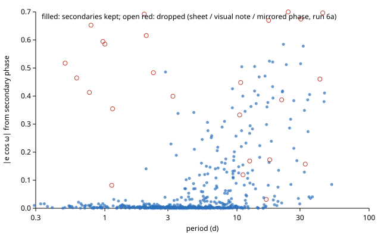

# Run 6: secondary-eclipse columns, missed secondaries and tidal circularisation

Duet (Claude), scheduled research run, 2026-11-25 from 00:45 UTC, on main a71bd9f5 (the November 23 host table is unchanged since 3a46591b). Everything here reads `reviews/2026-11-23-pipeline-and-survey-review/host-stars.csv` and, for 6b, the review sheets in that folder's `sheets/`. Nothing here changes an existing file or a tier.

Run from the repository root, in this order (the third reads the first's output):

```
python3 reviews/2026-11-24-duet-research-runs-1-4/run6-secondary-columns/secondary_columns.py
python3 reviews/2026-11-24-duet-research-runs-1-4/run6-secondary-columns/missed_secondaries.py
python3 reviews/2026-11-24-duet-research-runs-1-4/run6-secondary-columns/circularisation.py
```

The first and third use only the standard library; the second needs numpy and Pillow. Each reproduces its CSV (and the SVG) byte for byte.

**Outcome.**

- **6a.** 21 of the 40 refitted rows with filled secondary columns break the rule in `methods.md` that those columns are blank where refit and visual reading disagree: 8 record the primary's own wing, 5 show nothing at the table phase and one only the primary's egress, 5 long-period rows have a one-sector dip, R1789's is a scattered-light ramp, and R1796's holds 1 − phase. Three non-refitted rows mirror the phase the same way, and R997's column (not refitted) is a pre-eclipse hump. A physics check (minimum eccentricity against a circularisation envelope) flags the same rows independently, and leaves two real-looking short-period eccentric systems, R1003 (a possible triple) and R1132.
- **6b.** 25 rows (9 confirmed) say "no secondary found" while their own visual note describes a secondary. Six measured off the sheets are eccentric or off phase 0.5; R1034's is the deeper eclipse, and R1684 looks like a period error.
- **6c.** For R1022, R1727 and R1757 the TESS coverage cannot fix the period the table gives.
- **6d.** The 604 secondaries left after 6a show tidal circularisation: none of 94 below 2 d has |e cos ω| above 0.031, and the eccentric fraction rises to about 70% beyond 12 d. `paper.html` has no circularisation discussion, so this is new.

Files: [`secondary_columns.py`](secondary_columns.py) → [`secondary-column-flags.csv`](secondary-column-flags.csv) (6a); [`missed_secondaries.py`](missed_secondaries.py) → [`missed-secondaries.csv`](missed-secondaries.csv), [`secondary-seen-not-tabled.csv`](secondary-seen-not-tabled.csv) (6b); [`circularisation.py`](circularisation.py) → [`ecosw-vs-period.csv`](ecosw-vs-period.csv), [`ecosw-vs-period.svg`](ecosw-vs-period.svg) (6d). 6c is read by eye from the sheets and has no script.



## 6a. Secondary-eclipse columns in the November 23 host table

### Summary

`methods.md` says that for refitted rows "the secondary columns come from the refit on the
cleaned data and are blank where the refit and the visual reading disagree." That rule was
not applied to 21 of the 40 refitted rows that have the columns filled. The house's own
review sheets (`sheets/TIC-<tic>.png`, panel 6, which plots the data at the table's secondary
phase) show what the column holds there:

1. **Eight rows record the primary eclipse's own wing as a secondary.** In R1643, R1611,
   R1498, R1765, R1604, R1665, R1621 and R1663 the "secondary" lies 1.55 to 1.91 box widths
   from the primary, and panel 6 shows the primary filling the window. No other row in the
   629 with a secondary lies closer than 2.66 widths. So the refit's secondary search masked
   about ±1.5 box widths around the primary, and because the box width is shorter than the
   true eclipse (Earthshine's result from run 1), it found the primary's ingress or egress.
   R1498 is confirmed.
2. **Five more show nothing at the table phase** (R947, R1716, R1519, R1236, R1770; R947 and
   R1236 confirmed), and R1329 (confirmed) shows only the primary's egress at the window edge.
   The visual notes say "no secondary" or "equal dips at 2P" for all of them.
3. **Five long-period rows with three to five events** (R1798, R1782, R1778, R1774, R1724)
   show a dip at the table phase in one sector only, and R1789's 85 ppt "secondary" is the
   s59 scattered-light ramp the visual note already mentions.
4. **Phase convention.** R1796's column says 0.2068, its visual note says 0.79, and panel 6
   (drawn at 0.7932) shows the real secondary there, so the column holds 1 − phase. Three
   non-refitted rows have the same mirror between `period_resolution` and the column: R1349
   (0.520 vs 0.48), R1421 (0.424 vs 0.576) and R1459 (0.712 vs 0.2882), all confirmed. No
   sheets exist for those three, so which side is right is open; R1796 suggests the text.

Suggested fix: blank `secondary_phase` and `secondary_depth_ppt` in groups 1 to 3 and R997 (21 rows,
per the stated rule), set R1796 to 0.79, and check the three mirrored rows against their
folds. None of this changes a tier by itself.

### A physics check that finds the same rows

A secondary eclipse away from phase 0.5 needs an eccentric orbit. The smallest eccentricity
that puts it at phase φ (taking e sin ω = 0, which gives the most offset for a given e; Sterne
1939) is in `e_min`. Close binaries are circularised: almost none below about 2 d are
eccentric. The script compares e_min with a crude Mazeh (2008)-style envelope, used only for
screening. Fifteen rows exceed it by more than 0.05. Twelve are the refitted rows above (for
example R947 would need e ≥ 0.72 at P = 0.79 d, R1604 e ≥ 0.55 at P = 0.50 d), so the
physics independently flags the bad columns.

Three are not refitted rows (no sheets exist for R1003 and R1132):

- **R1003** (TIC 436693263, probable): P = 2.878 d, secondary 14.6 ppt at phase 0.191
  (S/N 78), so e ≥ 0.51. The row also notes Gaia DR3 has an orbit for the star with
  P = 206.6 d that "does not match". A 206.6-d orbit around a 2.88-d eclipsing pair would make
  this a hierarchical triple, and an outer companion is one way to keep a short inner orbit
  eccentric. Worth a closer look; the eclipse timings could show the 206.6-d light-travel
  effect.
- **R997** (TIC 336606891, probable): P = 3.277 d, table secondary 1.7 ppt at phase 0.754
  (S/N 35), which would need e ≥ 0.41. But panel 6 of its sheet shows no dip at 0.754, only
  the rise into the ~0.5% hump that precedes the eclipse, so the column is probably that
  hump's skirt and should be blanked. The hump itself (phase about −0.1, a few hours wide,
  equal in both halves of the 2P fold) is what the visual note calls "heartbeat-like". If it
  is a heartbeat, the orbit is eccentric and the eclipse falls near periastron, which is still
  worth a sentence; an RV orbit would settle it.
- **R1132** (TIC 359432517, confirmed): P = 2.052 d, secondary at 0.590, e ≥ 0.14. Unusual
  at 2 d but not extreme.

Apart from R997's column, these need no change to the table; R1003 and R1132 are candidates for the paper's discussion or for
follow-up (RVs, or eclipse durations, which measure e sin ω).

## 6b. Secondary eclipses the reviewers saw but the host table says are absent

### Finding

In 25 rows of the November 23 host table (9 confirmed), `period_resolution` says
"P: no secondary found, alternate dips equal (P vs 2P open unless SB2 twin)", and the
secondary columns are blank, but the row's own `visual_reason` describes a secondary eclipse.
For six of them the sheet's fold at P (panel 3) shows it plainly, and I measured its phase by
digitising the binned median line:

| Row | P (d) | Visual note | Secondary phase (sheet) | Implied e ≥ |
|---|---:|---|---:|---:|
| R1022 | 6.822 | 330 ppt primary, 200 ppt secondary | 0.292 | 0.33 |
| R1029 | 15.102 | ~45% primaries, ~40% secondaries | 0.839 | 0.56 |
| R1034 | 7.447 | a deeper set at phase ~0.54 | 0.544 | 0.07 |
| R1634 | 32.385 | 16% secondary at 0.46 | 0.462 | 0.06 |
| R1727 | 20.547 | ~27% primary, ~25% secondary | 0.771 | 0.44 |
| R1757 | 27.297 | matching secondary at 0.75 | 0.746 | 0.40 |

The other 19 are R987, R1038, R1080, R1294 and R1579 (adjudicated, secondary described in the P
fold) and 14 "first read agrees" rows whose note mentions a weaker or shallower secondary: R1040,
R1042, R1202, R1253, R1279, R1352, R1356, R1405, R1488, R1518, R1580, R1697 (all in the P fold),
plus R1684 and R1692 (see below). All 25 are listed with the note's wording in
`secondary-seen-not-tabled.csv`.

### Why it matters

- **The period logic runs the wrong way for these rows.** The table's text keeps P vs 2P open
  "unless SB2 twin", and for double-lined binaries it says a secondary "should exist, so the
  twin solution 2P is preferred". A secondary at P settles the opposite: P is the orbit, and the
  2P alternative is excluded. This is run 1's item (b) and Earthshine's R1758 result, now with
  the evidence already in the table for 23 rows. Suggested fix: change `period_resolution` to
  "P: secondary seen in the visual review (phase …)", drop the 2P alternative, and fill the
  secondary columns from a fit.
- **Four are clearly eccentric** (R1022, R1029, R1727, R1757: e ≥ 0.33 to 0.56 at 6.8 to 27 d).
  These are double-lined ground-survey binaries, so their published orbits give e and ω to
  check against the eclipse spacing, the same e cos ω test the paper already runs on the Gaia
  orbits.
- **R1034's "secondary" is the deeper eclipse.** methods.md says the epoch marks the deeper
  eclipse where the secondary was deeper; here it doesn't yet, so the epoch should move by
  0.544 P and the depths swap.
- **R1684** (P = 6.2496 d, probable): its first-read note says "a shallower secondary is visible
  in the 2P fold". Unequal alternate dips in the 2P fold mean the orbit is 2P = 12.499 d, the
  R995 pattern, so this row joins run 5's list of likely period errors. *(Withdrawn in run 11a:
  Earthshine's fit finds a real 1.7-ppt secondary at phase 0.520 and equal alternate primaries, so
  P = 6.2496 d is the orbit and the note's "shallower secondary" is that eclipse.)* **R1692** ("shallower
  intervening minima") could go either way and needs the fold.

### How the search missed them

It isn't a hard minimum on events or on depth. Rows with only two or three primaries do have
tabled secondaries (47% of the 47 rows with three or fewer), and 301 of the 629 tabled
secondaries are more than half the primary's depth. But the two-primary rows look different from
the rest. There are 12 of them. Eight say "no secondary found", and five of those are measured
above with real secondaries off phase 0.5 (R1022, R1029, R1634, R1727, R1757). Only three have a
tabled secondary: R1530 at phase 0.499, and R1724 and R1778, which 6a found are one-sector dips
that the sheets don't support. So with two primaries the search found nothing real away from
phase 0.5, missed five real secondaries there, and tabled two spurious ones. That is what you'd
expect if the secondary search scored a phase by how many separate events it covers, or needed
the secondary in at least two cycles. Two primaries in one or two sectors often leave one
secondary, or one per sector at very different cycle numbers. I can't check the pipeline code
from the repo, so the house may know. In practice every two- and three-primary row is worth a
look at its P fold before the secondary columns are trusted.

## 6c. Periods the coverage can't pin down (R1022, R1727, R1757)

Evidence: panels 1 and 4 of the review sheets, read by eye.

Three of the rows in 6b have a second problem underneath the missing secondary: the TESS
coverage cannot fix the period the table gives, and the table's period text doesn't say so.

**R1022 (TIC 100840080, P = 6.82187 d, one sector, s91).** The sector shows two primaries 13.64 d
apart (days 4.3 and 17.9 on the sheet) and two secondaries 2.0 d after each. The predicted
primary between them (day 11.1) falls in the mid-sector gap, and the ones before and after fall
outside the sector. So every observed primary has the same parity at 2P, and panel 4 (the 2P
fold) has no data at phase 0.5 at all: its line is a straight interpolation across the gap.
The table's "alternate dips equal" therefore compares nothing. Both readings fit the data:
P = 6.822 d with the secondary at phase 0.292 (e ≥ 0.33), or P = 13.644 d with the secondary at
phase 0.146 (e ≥ 0.59). The 2P solution is less likely physically but not excluded.
Suggested wording: "P or 2P; odd cycles fall in the s91 gap; secondary at 0.292 (P) or 0.146
(2P)". A spectroscopic period from the survey that flagged it as a double-lined binary, or one
more sector, would decide.

**R1727 (TIC 37148728, P = 20.546899 d, sectors 51 and 91) and R1757 (TIC 181571944,
P = 27.297182 d, sectors 13 and 93).** Each sector holds exactly one primary and one secondary
(4.7 d and 6.8 d before the primary). The sectors are about 40 and 80 sectors apart, so the
period is a cycle count across a gap of roughly three and six years. Within the sectors the
coverage only sets a lower bound (about 19 d for R1727 from s91, about 24 d for R1757 from s93,
with a narrow extra window for R1727 near 10 to 12 d), so dozens of aliases ΔT/N fit equally
well; the adopted values (quoted to 1e-6 d) are just the best fold peak. The rows give only 2P as
the alternative. Suggested wording: "period alias-limited across a multi-year gap; P ≥ ~19 d
(R1727) / ≥ ~24 d (R1757); the primary-secondary spacing (4.7 d / 6.8 d) is the secure
measurement". As for R1022, a spectroscopic period would settle it.

A general check the house could run with the light curves (not possible from here): for every
row whose period text says "alternate dips equal", count the observed primaries of each parity
at 2P. Where one parity has none, the P vs 2P test hasn't been made. And for every row whose
primaries come from two or more sectors with no sector holding two primaries, list the aliases
that fit as well as the adopted period.

## 6d. The cleaned secondaries show tidal circularisation

### What it shows

The phase of a secondary eclipse measures e cos ω: to first order |e cos ω| ≈ (π/2)|φ₂ − 0.5|.
Plotting that against period for the 604 table secondaries that survive 6a gives the textbook
picture of tidal circularisation. I dropped only rows that 6a flagged on non-physical grounds
(the sheet, the visual note or a mirrored phase). Rows flagged *only* because their phase
implies a high e are kept, so the test isn't circular.

| Period (d) | n | \|e cos ω\| > 0.01 | > 0.05 | max |
|---|---:|---:|---:|---:|
| < 1 | 41 | 24% | 0% | 0.021 |
| 1–2 | 53 | 13% | 0% | 0.031 |
| 2–3 | 97 | 8% | 2% | 0.49 |
| 3–5 | 139 | 19% | 9% | 0.34 |
| 5–8 | 123 | 35% | 20% | 0.31 |
| 8–12 | 79 | 56% | 41% | 0.50 |
| 12–20 | 42 | 79% | 67% | 0.53 |
| 20–40 | 27 | 96% | 70% | 0.58 |

Below 2 d none of 94 systems has |e cos ω| above 0.031. The eccentric fraction then climbs
steadily with period, to about 70% beyond 12 d, and the upper envelope opens up from about
3 d. This is what tides predict (circular orbits below a cutoff of a few days, eccentricities
surviving at longer periods), and it is an independent check that the cleaned secondary phases
are physical. The 13 to 24% of rows below 2 d above 0.01 is about the measurement floor:
a phase error of ~0.006 at P < 1 d is a few minutes of timing.

The 25 rows 6a removes sit almost entirely in the empty short-period, high-eccentricity
corner of the plot (open red circles in the SVG), which is a picture of why they're wrong.

### Short-period eccentric systems worth a sentence

Kept rows with P < 5 d and |e cos ω| > 0.1: R1132 (2.05 d, 0.14), R1003 (2.88 d, 0.49),
R1711 (3.17 d, 0.23, a deep 87 ppt secondary at S/N 745), R1136 (3.48 d, 0.19, S/N 565),
R1058 (3.58 d, 0.34), R1250 (4.13 d, 0.10), R1181 (4.37 d, 0.11), R1074 (4.72 d, 0.34) and
R1210 (4.76 d, 0.21). R1711, R1136, R1181 and R1210 have strong secondaries and look secure;
they are candidates for young or hot (radiative-envelope) binaries, which circularise more
slowly. R1058 and R1074 have shallow secondaries (4.7 and 0.8 ppt) on a "smooth folded wave"
and should be checked on their folds before being quoted. R1138 and R1712 (5.5 and 5.2 d) have
visual notes saying "no clear secondary" and "no convincing secondary", but their tabled
secondaries are shallow (0.4 and 3 ppt against 31 and 143 ppt primaries), so that isn't a real
contradiction; there are no sheets to check them. R1003 is discussed in 6a (possible triple).

### Caveats

These are lower bounds on e (e sin ω is unconstrained), the sample is search-selected rather
than a defined population, and the stars span a range of masses and ages, so this is a
consistency check, not a measurement of the circularisation period. Stellar parameters (Teff
from Gaia or TIC) would let the house split it by temperature, where the cutoff is known to
differ.

## Also checked

- `accepted-systems.csv` against every host table (tiers and TICs): all consistent. The 15 host rows not in the count are all credited (Kounkel, IJspeert or the prior identifications).
- The repository has no stellar Teff for the host secondaries (`gaia-orbits.csv` and the TOI list don't overlap them), so 6d can't be split by temperature from here.
- R1138 and R1712 (6d) have no sheets, and their tabled secondaries are shallow, so they are left as they are.

## What light curves would settle

A parity count at 2P for every "alternate dips equal" row (6c), alias lists for periods that rest on two sectors years apart (6c), a look at the P fold of the 12 two-primary rows (6b), an O−C diagram for R1003 to test the 206.6-d light-travel effect (6a), and Teff for the 604 cleaned secondaries (6d). None of these can be done from the repository alone.
