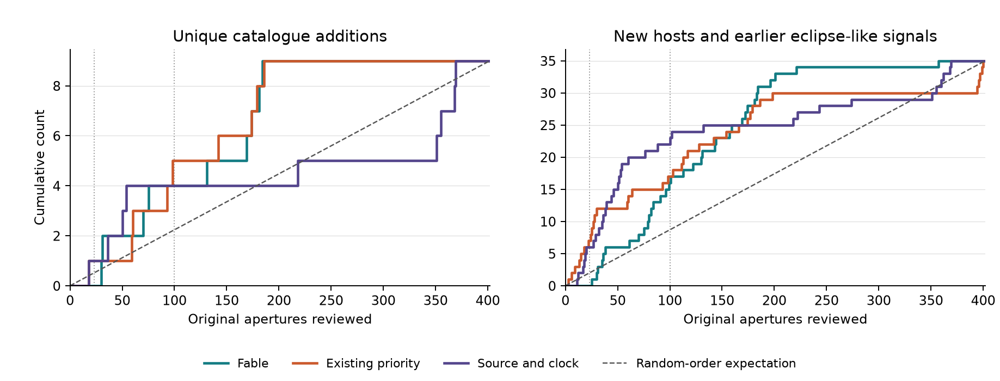

# Which preliminary measurements helped prioritize review?

The review added 9 unique hosts from 402 outstanding Fable apertures (6 confirmed and 3 probable). It also identified previously reported eclipse-like signals in 26 apertures. 5 apertures had a directly identified alternative or a refuted signal, 100 remained unresolved, and 262 lacked adequate evidence.

## Number recovered at a fixed review budget

| Order frozen before review | New hosts in first 23 | New hosts in first 100 | Previously identified eclipse apertures in first 23 / 100 |
|---|---:|---:|---:|
| Fable | 0 / 23 (0 confirmed) | 4 / 100 (3 confirmed) | 0 / 12 |
| Existing priority | 1 / 23 (0 confirmed) | 5 / 100 (3 confirmed) | 6 / 12 |
| Source and clock | 1 / 23 (1 confirmed) | 4 / 100 (2 confirmed) | 5 / 19 |

A random ordering of this same cohort would average 0.51 additions in 23 reviews and 2.24 in 100. All orders reach the same 9 at the end. The random line shows the mathematical expectation over orderings.

## What this suggests for the next queue

The observing stream had the largest observed yield difference. The full-frame stream produced 9 additions from 67 apertures and the two-minute stream produced 0 from 335. Additional follow-up reached 55/67 full-frame apertures and 40/335 two-minute apertures. The difference mixes the candidate populations, data available and review effort.

Within the full-frame stream alone, the first 17 apertures produced 4 additions under Fable rank, 1 under existing priority and 1 under the composite. The pooled comparison therefore cannot establish a generally superior ranking.

The original blind period check failed to agree for 6 of the 9 eventual additions. A score of zero still yielded 4 additions among 60 apertures, while all four indicators together yielded 0 among 7. An initial clock disagreement merits another period search when independent event times support one.

The absence of a flux-capable neighbour showed a possible enrichment (4/114 versus 5/288). With 9 additions total, differences of one or two systems can change the apparent ranking. The composite can prioritize earlier eclipse signals as well as new hosts, so keep both yields visible when comparing another cohort. In the full-frame stream the corresponding counts were 4/16 without a capable neighbour and 5/51 with one.

Among the 40 apertures with a resolved endpoint, 9 contributed a new host (22.5%). The full-queue yield remains 2.2%. Dropping holds from the denominator selects the systems for which the team could resolve the signal and attribute a source.

To reach every eventual addition in this cohort required 184 reviews under Fable rank, 186 under existing priority and 369 under the composite.

## Individual preliminary indicators

| Indicator present | Additions / examined with indicator | Additions / examined without indicator | Holds with / without indicator |
|---|---:|---:|---:|
| Blind search recovers original period | 3 / 164 | 6 / 238 | 134 / 228 |
| Four significant events covering half of measured cycles | 4 / 228 | 5 / 174 | 198 / 164 |
| Narrow profile with secondary or alternating depths | 2 / 130 | 7 / 272 | 113 / 249 |
| No flux-capable neighbour within 42 arcsec | 4 / 114 | 5 / 288 | 105 / 257 |
| Passed earlier photometry cut | 1 / 32 | 8 / 370 | 19 / 343 |
| Clear in earlier position and period comparison | 9 / 384 | 0 / 18 | 354 / 8 |

Observed catalogue yield was 2.2% (Wilson 95% interval 1.2–4.2%). Treating all 362 unresolved or insufficient apertures as eventual successes would raise the arithmetic upper bound to 92.3%. That upper bound illustrates how little the pass says about the true prevalence of eclipses among holds.

The cohort contained 335 two-minute apertures and 67 full-frame apertures. 95 received at least one additional follow-up recorded in the adjudications. Selective follow-up affects which systems can clear the catalogue threshold. These estimates apply to the remainder of Fable’s selected shortlist. The 45 earlier cases informed the existing priority cut and were excluded from every comparison.

The accompanying tables give separate confirmed, probable, prior-signal, directly refuted and unresolved counts, the two observing streams at equal relative budgets, and subgroup Wilson intervals. The composite adds one point for each of the first four indicators and breaks ties by Fable rank. See [the original analysis plan](analysis-plan.md).

The initial pass added eight hosts. A later inspection of the saved fold depths led to further observations and the ninth admission, probable TIC 247999198. The ranking inputs and their order were already fixed. The final set of proved outcomes reflects that additional effort, particularly for the retrospective fold-depth comparison.

A [separate exploratory comparison](exploratory-fold-discrepancy.md) tests a clue noticed after the recovered clocks were inspected.
