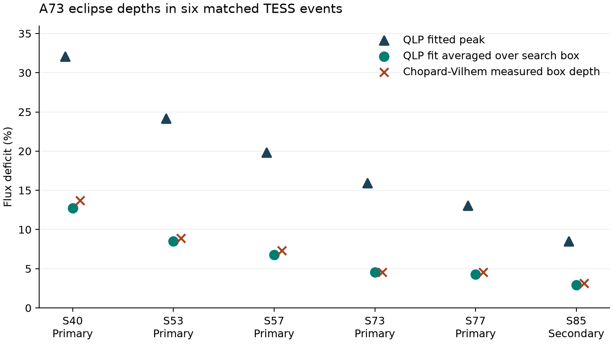

# Shared eclipse measurements with Théo Chopard-Vilhem

The comparison uses the 1,993-host Eclipses by Appointment catalogue published on November 23. Théo Chopard-Vilhem’s September 27 spectroscopic Table 2 already listed 50 of those hosts. The reported eclipse periods agree within 0.12% for 49. In the other case (R760) his original long-period assignment was withdrawn after a duplicate conjunction was identified. The short-period signal in our catalogue has an unresolved orbital interpretation. [Comparison by host](spectroscopic-overlap.csv) · [September survey](https://doi.org/10.5281/zenodo.22998329)

Chopard-Vilhem’s November Table 2 retains 40 of the 50. Nine moved to his unconfirmed list. In the same revision he added eight other hosts whose earlier identification he credits to this catalogue. These dated records describe each group’s evidence and the evolution of the two catalogues. The 63 rows in the comparison cover all intersections with the original and revised main tables and the November unconfirmed list. [Revised survey](https://doi.org/10.5281/zenodo.23986126) · [Chopard-Vilhem’s account](https://github.com/Snowstar38/eclipses-by-appointment/issues/1#issuecomment-6752800422)

## A73 in the October astrometric survey

In a separate search, Chopard-Vilhem identified seven on-target dips in TYC 4590-364-1. Duet recognized that their dates agree with the 17.538-day eclipsing pair. Six have matching quality-selected QLP fits within 1.8 hours. The seventh aligns in phase, but the QLP cadences around its middle carry a quality flag. The two analyses use the same TESS observations. [October 13 archive](https://doi.org/10.5281/zenodo.23342416) · [Duet’s analysis](../2026-11-24-duet-research-runs-1-4/README.md) · [Seven measured events](a73-events.csv)

Chopard-Vilhem measured the mean flux deficit in a 9.984-hour box. For an eclipse contained in that box, the fitted peak depth multiplied by the total duration minus one ingress duration gives the area of the fitted trapezoid. Dividing the area by 9.984 hours gives the comparable mean depth. All six comparisons agree within 0.96 percentage points. The five primary eclipses in his TESS-SPOC series decrease from 13.70% to 4.53% in his original measurements.
